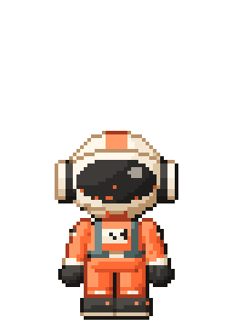
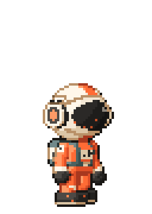
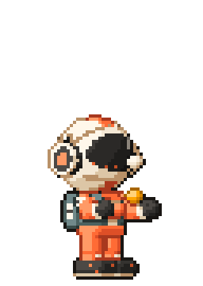
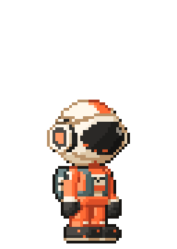
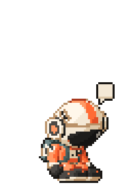
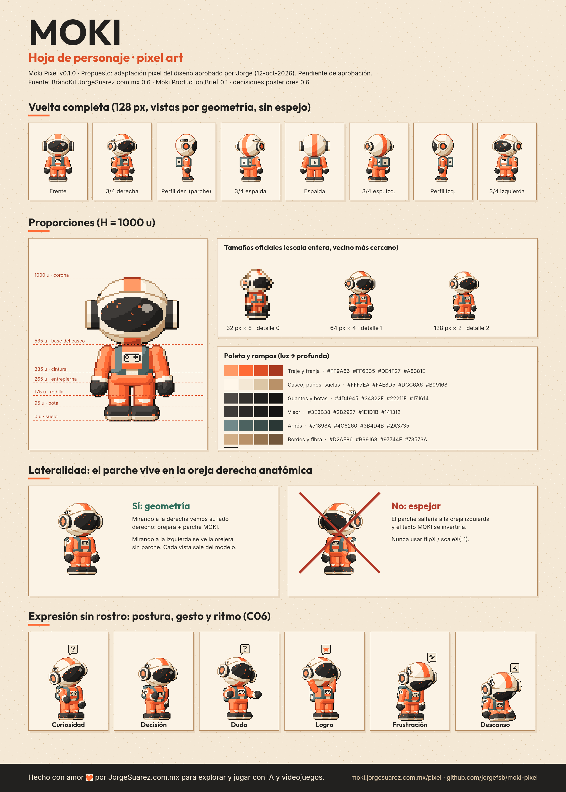
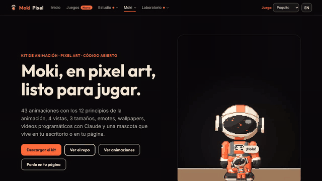
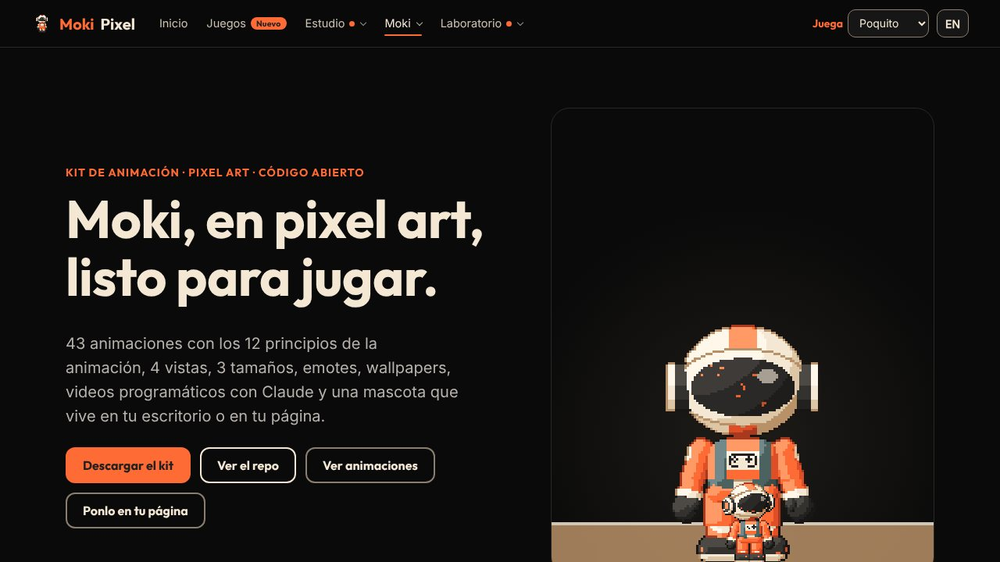
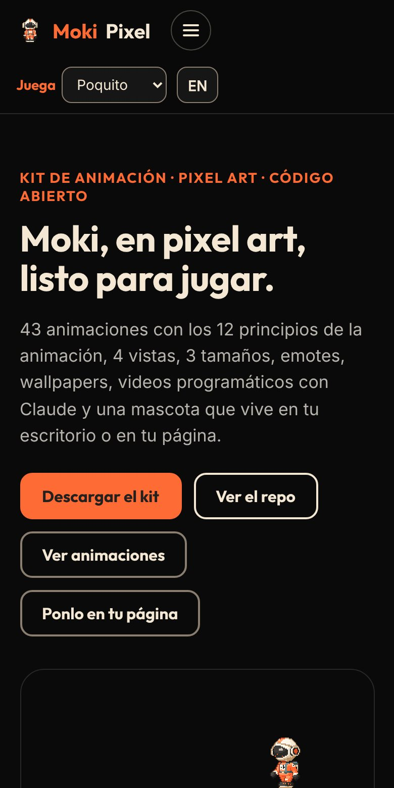

<div align="center">

<a href="https://moki.jorgesuarez.com.mx/pixel/"></a>

<br />

<a href="./README.md"></a>


<br />

**[▶ Verlo en vivo](https://moki.jorgesuarez.com.mx/pixel/)** · Más proyectos en [github.com/jorgefsb](https://github.com/jorgefsb)

</div>

---

<p align="center">
  
  
  
  
  
</p>
<p align="center"><sub>Animaciones reales del kit, tal como salen de <code>dist/gif</code>.</sub></p>

## ¿Qué es?

Un kit abierto de animación para usar a Moki en juegos, páginas, apps, wallpapers, videos y en tu escritorio. Moki es el alter ego explorador de Jorge Suárez: descubre, se equivoca y construye mundos mientras aprende.

## ¿Para quién es?

- Para quien hace juegos en Phaser, Godot, Unity o GameMaker y quiere un personaje ya animado.
- Para quien tiene una página y quiere una mascota que camine por ella.
- Para quien usa Claude Code y quiere a Moki en su escritorio reaccionando a lo que hace.
- Para quien quiere hacer GIFs y videos con un personaje desde un guion.

## ¿Qué dolor resuelve?

Un personaje que solo existe como ilustración no se puede jugar. Para meterlo a un juego o a una página hay que dibujar cada cuadro, cada vista y cada tamaño, y al voltear el sprite se rompen detalles como el parche de la oreja.

## La propuesta

Moki no está dibujado cuadro por cuadro. Vive como un maniquí 3D sencillo que se convierte a pixel art, así que cualquier vista o tamaño sale consistente y el parche nunca cambia de lado. Lo hicimos para explorar y jugar con IA y videojuegos, y lo abrimos para que cualquiera pueda hacer lo mismo.

| Qué trae | Detalle |
|---|---|
| 43 animaciones | Locomoción, salto, gestos, emociones, actividades, descanso y modo mascota |
| 4 vistas | Derecha, izquierda, frente y espalda |
| 3 tamaños | 32, 64 y 128 px |
| 12 emotes y FX | Burbujas sobre el casco, polvo, chispas, confeti y sombra |
| Exportes para motores | Aseprite JSON (Phaser), Godot 4, GameMaker y Unity |
| Mascota web y de escritorio | macOS, Windows y Linux, con hooks de Claude Code |
| Videos y wallpapers | Guion JSON a MP4, WebM o GIF; 4 escenas en 6 tamaños |

<p align="center"></p>

## ¿Cómo se usa?

En tu página, con una línea:

```html
<script src="https://moki.jorgesuarez.com.mx/pixel/dist/runtime/moki-pet.js" data-juice="poquito"></script>
```

En tu juego con Phaser 3:

```js
this.load.aseprite('moki', 'moki-64-right.png', 'moki-64-right.json');
this.anims.createFromAseprite('moki');
this.add.sprite(160, 120, 'moki').play({ key: 'walk', repeat: -1 });
```

En tu escritorio: descarga el instalador en [Releases](https://github.com/jorgefsb/moki-pixel/releases).

Componente web, Godot, Unity, GameMaker, videos y la skill para Claude están en la [guía completa](./docs/GUIA.md).

## ¿Cuándo conviene y cuándo no?

Conviene si quieres un personaje con animaciones listas para un prototipo, una página, un stream o un video.

Ten en cuenta:

- El arte de Moki no es para uso comercial sin permiso (CC BY-NC 4.0).
- Nunca espejes el sprite: usa el atlas `left`. El parche MOKI vive solo en su oreja derecha.
- Los instaladores de escritorio todavía no están firmados: macOS y Windows muestran un aviso.

## ¿Dónde lo pruebo?

En vivo: **[moki.jorgesuarez.com.mx/pixel](https://moki.jorgesuarez.com.mx/pixel/)**

<p align="center"></p>
<p align="center"><sub>Recorrido real del sitio en vivo, grabado el 10 nov 2026 en Chromium (1280×720). Sin retoque. Se reproduce una sola vez; recarga la página para verlo de nuevo. <a href="docs/readme/tour.mp4">Ver el video MP4</a></sub></p>

<p align="center">
  
  
</p>
<p align="center"><sub>Capturas reales del sitio en vivo, 10 nov 2026: escritorio (1280×720) y móvil (390×780).</sub></p>

## Hasta dónde llegamos

Versión 0.1.0. El diseño de Moki está aprobado desde el 12 de octubre de 2026; esta adaptación a pixel art es una propuesta sobre ese diseño.

Pendiente, con corte al 30 de octubre de 2026: la aprobación del kit, la prueba física de la mascota de escritorio en macOS, Windows y Linux, y la firma de los instaladores. El detalle vive en [docs/estado.md](./docs/estado.md).

## Para quien construye

```bash
npm install
npm run build        # sprites, tiras, Godot, GIFs, FX, runtime, hoja y wallpapers
npm run site         # sitio para moki.jorgesuarez.com.mx/pixel
```

Cómo está hecho, el canon de Moki y todas las integraciones: [guía completa](./docs/GUIA.md). Guías por tema: [personaje](./docs/guia-de-personaje.md), [arte pixel](./docs/guia-de-arte-pixel.md), [animación](./docs/animacion.md) y [escenas y video](./docs/escenas.md).

## Licencia y créditos

- Código: [MIT](./LICENSE).
- Arte de Moki: [CC BY-NC 4.0](./LICENSE-ART.md). Da crédito a «Moki por JorgeSuarez.com.mx» y escríbenos para usos comerciales.
- La idea nació viendo [Clawd](https://github.com/KebeliSamet0/clawd) de KebeliSamet0, una mascota pixel art de Claude para Windows.

---

<div align="center">

<sub>Hecho con amor ❤️🎮 por <a href="https://jorgesuarez.com.mx">JorgeSuarez.com.mx</a> · <a href="https://github.com/jorgefsb">Más proyectos</a> · <a href="./README.md">Read in English</a><br />Documentación actualizada el 10 nov 2026.</sub>

</div>
