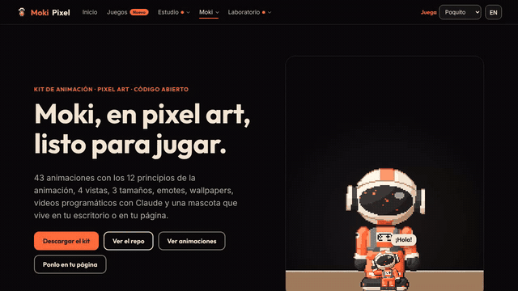
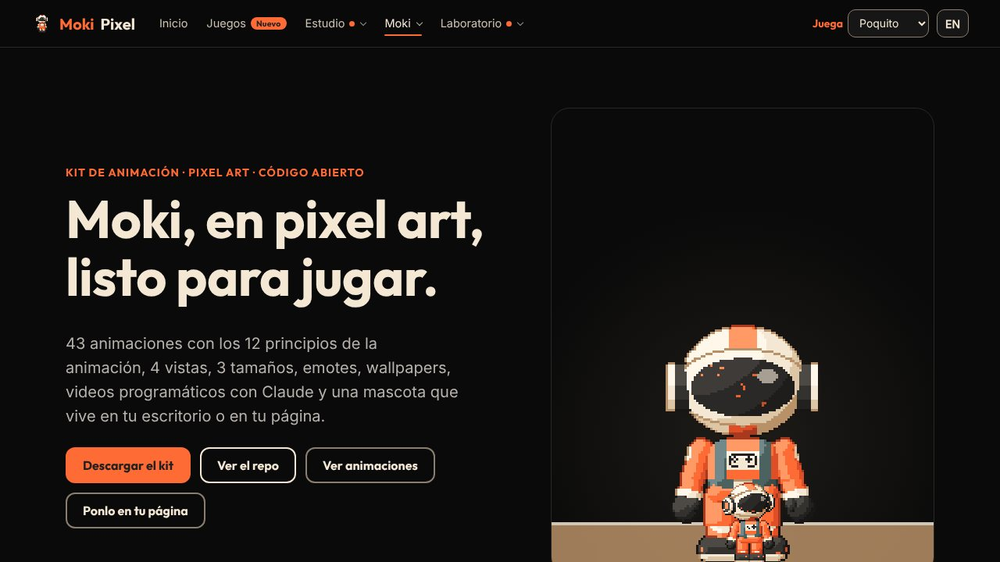
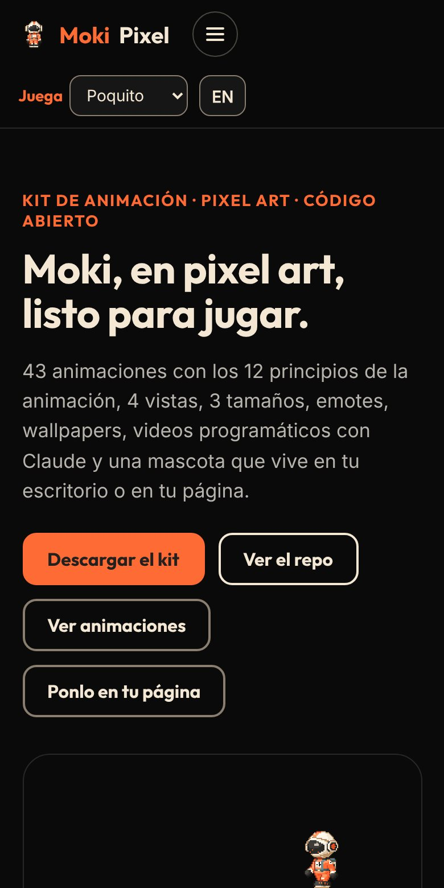

<div align="center">

<a href="https://moki.jorgesuarez.com.mx/pixel/"></a>

<br />


<a href="./README.es.md"></a>

<br />

**[▶ See it live](https://moki.jorgesuarez.com.mx/pixel/)** · More projects at [github.com/jorgefsb](https://github.com/jorgefsb)

</div>

---

<p align="center">
  
  
  
  
  
</p>
<p align="center"><sub>Real animations from the kit, straight out of <code>dist/gif</code>.</sub></p>

## What is it?

An open animation kit to use Moki in games, pages, apps, wallpapers, videos and on your desktop. Moki is Jorge Suárez's explorer alter ego: he discovers, gets things wrong and builds worlds while he learns.

## Who is it for?

- People making games in Phaser, Godot, Unity or GameMaker who want a character that is already animated.
- People with a website who want a pet walking around it.
- People who use Claude Code and want Moki on their desktop reacting to what they do.
- People who want to make GIFs and videos with a character from a script.

## What pain does it solve?

A character that only exists as an illustration cannot be played. To put it in a game or on a page you have to draw every frame, every view and every size, and flipping the sprite breaks details like the ear patch.

## The proposal

Moki is not drawn frame by frame. He lives as a simple 3D mannequin that is converted to pixel art, so every view and size comes out consistent and the patch never changes sides. We made it to explore and play with AI and video games, and we opened it so anyone can do the same.

| What you get | Detail |
|---|---|
| 43 animations | Locomotion, jump, gestures, emotions, activities, rest and pet mode |
| 4 views | Right, left, front and back |
| 3 sizes | 32, 64 and 128 px |
| 12 emotes and FX | Bubbles over the helmet, dust, sparks, confetti and shadow |
| Engine exports | Aseprite JSON (Phaser), Godot 4, GameMaker and Unity |
| Web and desktop pet | macOS, Windows and Linux, with Claude Code hooks |
| Videos and wallpapers | JSON script to MP4, WebM or GIF; 4 scenes in 6 sizes |

<p align="center"></p>

## How do I use it?

On your page, with one line:

```html
<script src="https://moki.jorgesuarez.com.mx/pixel/dist/runtime/moki-pet.js" data-juice="poquito"></script>
```

In your game with Phaser 3:

```js
this.load.aseprite('moki', 'moki-64-right.png', 'moki-64-right.json');
this.anims.createFromAseprite('moki');
this.add.sprite(160, 120, 'moki').play({ key: 'walk', repeat: -1 });
```

On your desktop: download the installer from [Releases](https://github.com/jorgefsb/moki-pixel/releases).

The web component, Godot, Unity, GameMaker, videos and the Claude skill are covered in the [full guide](./docs/GUIA.md) (in Spanish).

## When it fits and when it doesn't

It fits if you want a character with ready-made animations for a prototype, a page, a stream or a video.

Keep in mind:

- Moki's art is not for commercial use without permission (CC BY-NC 4.0).
- Never mirror the sprite: use the `left` atlas. The MOKI patch lives only on his right ear.
- The desktop installers are not signed yet: macOS and Windows show a warning.

## Where can I try it?

Live: **[moki.jorgesuarez.com.mx/pixel](https://moki.jorgesuarez.com.mx/pixel/)**

<p align="center"></p>
<p align="center"><sub>Real walkthrough of the live site, recorded 10 Nov 2026 in Chromium (1280×720). No retouching. <a href="docs/readme/tour.mp4">Watch the MP4 video</a></sub></p>

<p align="center">
  
  
</p>
<p align="center"><sub>Real screenshots of the live site, 10 Nov 2026: desktop (1280×720) and mobile (390×780).</sub></p>

## How far we got

Version 0.1.0. Moki's design has been approved since 12 October 2026; this pixel art adaptation is a proposal built on that design.

Pending as of 30 October 2026: approval of the kit, a physical test of the desktop pet on macOS, Windows and Linux, and signing the installers. Details live in [docs/estado.md](./docs/estado.md) (in Spanish).

## For builders

```bash
npm install
npm run build        # sprites, strips, Godot, GIFs, FX, runtime, sheet and wallpapers
npm run site         # site for moki.jorgesuarez.com.mx/pixel
```

How it is made, Moki's canon and every integration: [full guide](./docs/GUIA.md). Guides by topic, in Spanish: [character](./docs/guia-de-personaje.md), [pixel art](./docs/guia-de-arte-pixel.md), [animation](./docs/animacion.md) and [scenes and video](./docs/escenas.md).

## License and credits

- Code: [MIT](./LICENSE).
- Moki's art: [CC BY-NC 4.0](./LICENSE-ART.md). Credit "Moki by JorgeSuarez.com.mx" and write to us for commercial use.
- The idea came from [Clawd](https://github.com/KebeliSamet0/clawd) by KebeliSamet0, a pixel art Claude pet for Windows.

---

<div align="center">

<sub>Made with love ❤️🎮 by <a href="https://jorgesuarez.com.mx">JorgeSuarez.com.mx</a> · <a href="https://github.com/jorgefsb">More projects</a> · <a href="./README.es.md">Leer en español</a><br />Documentation updated on 10 Nov 2026.</sub>

</div>
