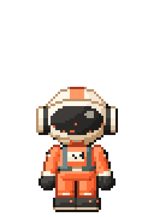
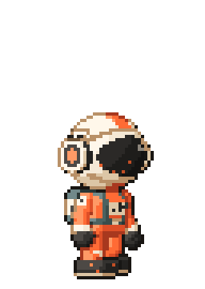
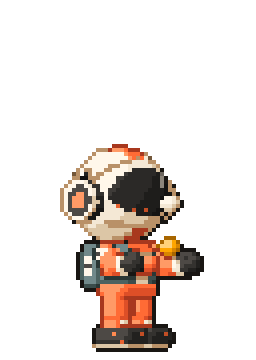
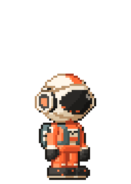
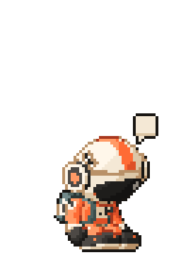
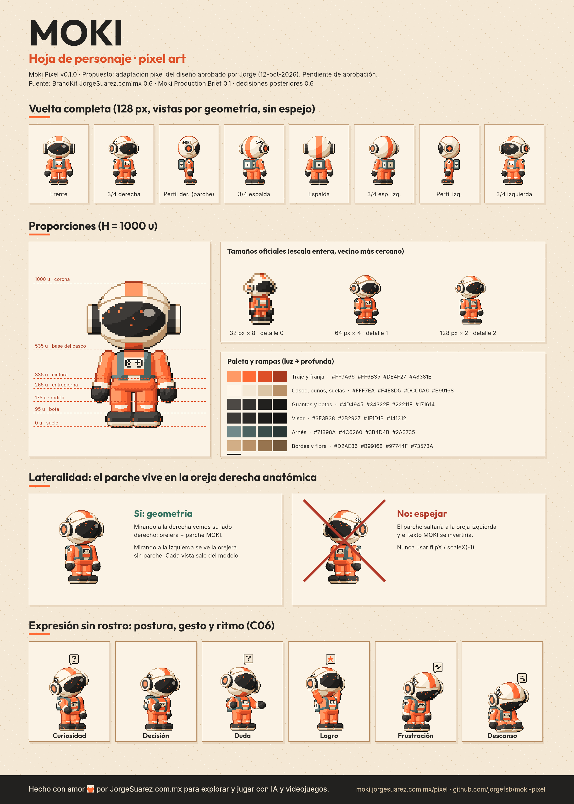

<p align="center">
  
  
  
  
  
</p>

# Moki Pixel

**Moki en pixel art, listo para jugar.** Un kit abierto de animación para usar a Moki en juegos, páginas, apps, wallpapers, videos y en tu escritorio.

Moki es el alter ego explorador de Jorge Suárez: descubre, se equivoca y construye mundos mientras aprende. Lo hicimos para explorar y jugar con IA y videojuegos, y lo abrimos para que cualquiera pueda hacer lo mismo.

> Hecho con amor ❤️🎮 por [JorgeSuarez.com.mx](https://jorgesuarez.com.mx) · Pruébalo en vivo: **[moki.jorgesuarez.com.mx/pixel](https://moki.jorgesuarez.com.mx/pixel/)**

## Qué trae

| | |
|---|---|
| **43 animaciones** | locomoción, salto por fases, gestos, emociones, actividades, descanso y modo mascota |
| **4 vistas** | derecha, izquierda, frente y espalda (locomoción en las 4 para juegos top-down) |
| **3 tamaños** | 32 px (ícono), 64 px (juego y mascota), 128 px (héroe, parche MOKI legible) |
| **12 emotes** | burbujas de papel sobre el casco: ! ? … idea estrella corazón Zz garabato nota palomita engrane «¡Ay!» |
| **FX** | polvo, chispas, confeti y sombra de contacto |
| **Exportes para motores** | Aseprite JSON (Phaser lo lee directo), Godot 4 SpriteFrames, tiras GameMaker, rejilla para Unity |
| **Anclas por cuadro** | cabeza, manos, pecho, mochila y pies, para colgar emotes, props o partículas |
| **Videos programáticos** | guion JSON → MP4, WebM o GIF en 16:9, 9:16, 1:1 y 4:5 |
| **Wallpapers** | 4 escenas × 6 tamaños (1080p, 1440p, 4K, ultrawide, iPhone, Android) |
| **Hoja de personaje** | vuelta completa, proporciones, paleta, lateralidad y expresiones |
| **Mascota web** | una línea de código y Moki camina por tu página |
| **Mascota de escritorio** | macOS, Windows y Linux (incluye Omarchy/Hyprland), con hooks de Claude Code |
| **Skill para Claude** | para que Claude genere escenas, GIFs y videos respetando el canon |

<p align="center"></p>

## Úsalo en 1 minuto

### En tu página web

```html
<script src="https://moki.jorgesuarez.com.mx/pixel/dist/runtime/moki-pet.js" data-juice="poquito"></script>
```

Niveles de juego (los mismos de la marca): `nada` · `poquito` · `mucho` · `hardcore`. Si la persona pidió movimiento reducido, Moki se queda quieto. API: `MokiPixel.pet.say('Hola')`, `.act('celebrate')`, `.walkTo(400)`, `.emote('idea')`, `.hide()`.

### Como componente (React, Vue, Svelte, Astro, HTML)

```html
<script type="module" src="https://moki.jorgesuarez.com.mx/pixel/dist/runtime/moki.mjs"></script>
<moki-sprite clip="play" facing="right" size="64" scale="3"></moki-sprite>
```

### En tu juego

```js
// Phaser 3
this.load.aseprite('moki', 'moki-64-right.png', 'moki-64-right.json');
this.anims.createFromAseprite('moki');
this.add.sprite(160, 120, 'moki').play({ key: 'walk', repeat: -1 });
```

Godot, Unity y GameMaker en [docs/integraciones.md](docs/integraciones.md).

### Un video con Claude

```bash
npm install
node tools/scene.mjs scenes/hola-moki.json --out hola.mp4
```

Claude puede escribir el guion por ti con la skill [`claude/skills/moki-pixel`](claude/skills/moki-pixel/SKILL.md).

### En tu escritorio

Descarga el instalador en [Releases](https://github.com/jorgefsb/moki-pixel/releases) o córrelo desde el código:

```bash
cd desktop && npm install && npm start
```

Con los hooks de Claude Code, Moki piensa cuando le escribes, teclea cuando edita, construye cuando corre comandos y celebra cuando termina. Ver [desktop/README.md](desktop/README.md).

## Las reglas de Moki (canon)

1. El parche **MOKI** vive solo en la oreja derecha anatómica. **Nunca espejes** el sprite: cada vista sale de la geometría y ya trae su lado correcto. Usa el atlas `left`, no `flipX`.
2. El visor **no tiene ojos, cejas, boca ni emoticonos**. Moki expresa con postura, gesto y ritmo; las emociones van en burbujas sobre el casco.
3. Casco crema con franja naranja, visor oscuro, traje naranja, guantes y botas oscuros, arnés petróleo. El emblema del pecho es fijo y distinto del control que sostiene.
4. Curioso y cercano. Nunca experto infalible ni torpe permanente, nunca agresivo de forma permanente.
5. Escala siempre en múltiplos enteros con vecino más cercano (`image-rendering: pixelated`).

Guías completas: [personaje](docs/guia-de-personaje.md) · [arte pixel](docs/guia-de-arte-pixel.md) · [animación y 12 principios](docs/animacion.md) · [escenas y video](docs/escenas.md) · [estado de aprobación](docs/estado.md).

## Cómo está hecho

Moki no está dibujado cuadro por cuadro: vive como un maniquí 3D sencillo (primitivas SDF con las proporciones del brief, H = 1000 u) que se rasteriza a pixel art con paleta cerrada, sombreado por bandas, contorno selectivo y líneas de traslape. Las animaciones combinan poses clave con capas procedurales, y el motor agrega acción continuada a la mochila. Por eso cualquier vista o tamaño sale consistente y el parche nunca cambia de lado.

```
src/core      modelo, paleta, render pixel, props y FX
src/anim      easing, muestreo y la biblioteca de 43 clips
src/runtime   reproductor web, <moki-sprite> y la mascota
tools         build, escenas/video, wallpapers, hoja de personaje, sitio
desktop       mascota de escritorio (Electron)
dist          todo lo generado, listo para usar
```

```bash
npm install
npm run build        # sprites, tiras, Godot, GIFs, FX, runtime, hoja, wallpapers
npm run site         # sitio para moki.jorgesuarez.com.mx/pixel
```

## Inspiración

La idea nació viendo [Clawd](https://github.com/KebeliSamet0/clawd) de KebeliSamet0, una mascota pixel art de Claude para Windows. Moki Pixel toma esa idea y la lleva a un sistema completo: más animaciones, más vistas, más plataformas y herramientas para crear con él.

## Licencias

- Código: [MIT](LICENSE).
- Arte de Moki: [CC BY-NC 4.0](LICENSE-ART.md). Da crédito a «Moki por JorgeSuarez.com.mx» y escríbenos para usos comerciales.

## Estado

Versión 0.1.0. Esta adaptación pixel art es una **propuesta** basada en el diseño de Moki que Jorge aprobó el 12 de octubre de 2026. Detalle en [docs/estado.md](docs/estado.md).

---

**EN:** Moki Pixel is an open pixel art animation kit for Moki, Jorge Suárez’s explorer alter ego: 43 animations built on the 12 principles of animation, 4 views, 3 sizes, emotes, engine exports (Phaser, Godot, Unity, GameMaker), programmatic videos, wallpapers, a web pet and a desktop pet for macOS, Windows and Linux that reacts to Claude Code. Code is MIT, Moki’s art is CC BY-NC 4.0. Made with love by JorgeSuarez.com.mx to explore and play with AI and video games.
