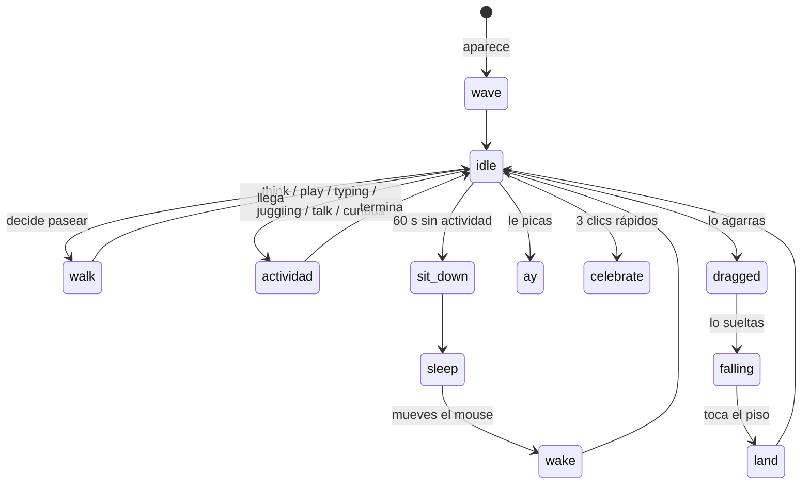

# Animación · los 12 principios en Moki

Los 12 principios clásicos de la animación (Thomas y Johnston, *The Illusion of Life*, 1981) son la base del sistema. Así se aplican en Moki, respetando el canon: casco y texto rígidos, aplastamiento del cuerpo ≤ 3 %, mochila con 2-3 cuadros de retraso.

| # | Principio | Cómo lo hace Moki | Dónde verlo |
|---|---|---|---|
| 1 | Aplastar y estirar | El cuerpo se comprime hasta 3 % y las piernas absorben; el casco nunca se deforma | `jump`, `land`, `celebrate`, `walk` |
| 2 | Anticipación | Se agacha antes de saltar, echa el brazo atrás antes de saludar o martillar | `jump`, `wave`, `building`, `point` |
| 3 | Puesta en escena | Una acción por pose, silueta legible a 64 px, brazo que señala hacia afuera de la silueta | `point`, `curious`, `push` |
| 4 | Directo y pose a pose | Gestos con poses clave; ciclos y física de forma procedural (directo) | `wave` vs `walk`, `dragged` |
| 5 | Acción continuada | La mochila sigue al torso con retraso y se asienta; curva `settle` al terminar | todos |
| 6 | Entradas y salidas lentas | Cada llave trae su curva (`inOut`, `out`, `in3`, `outBack`, `settle`) | todos |
| 7 | Arcos | Manos, bolas de malabar, saltos y el martillo viajan en arcos | `juggling`, `building`, `jump` |
| 8 | Acción secundaria | Respiración, cabeza que acompaña, mochila, brazos que equilibran | `idle`, `talk`, `jump_fall` |
| 9 | Timing | Exporta a 12 fps; los holds se crean solos cuando el dibujo no cambia | `point` (sostén), `think` |
| 10 | Exageración | Rebases `outBack` y saltos de logro, dentro del canon | `idea`, `celebrate`, `scared` |
| 11 | Dibujo sólido | Un modelo 3D proxy para todas las vistas: volumen consistente al girar | `turn` |
| 12 | Atractivo | Casco grande, cuerpo corto, ritmo juguetón; nunca torpe permanente | todo el personaje |

## Sistema

```
pose clave (llaves) ─┐
capa procedural (fn) ├─► muestreo (s) ─► follow-through mochila ─► render pixel ─► holds ─► atlas
easing por llave ────┘
```

- **Llaves acumuladas:** cada llave hereda lo que no especifica de la anterior.
- **Capa procedural:** ciclos (caminar, correr), respiración, malabares, péndulos.
- **Root motion:** la altura del salto sale del cuadro como `air`; la velocidad de los ciclos va en `speed` (px/s del tamaño).
- **Eventos:** `step`, `takeoff`, `land`, `hit` en el cuadro donde ocurren, para polvo, chispas o sonido.
- **Emotes:** cada clip puede traer su burbuja (`question`, `star`, `zz`…) con su tiempo.

## Máquina de estados de la mascota



## Agregar un clip

```js
// src/anim/clips.js
saludo_militar: {
  group: 'gestos', dur: 1.2, loop: false, facings: ['right', 'left', 'front'],
  note: 'Saludo con la mano en el casco.',
  principles: ['anticipacion', 'timing'],
  keys: [
    [0, {}],
    [0.2, { armR: [10, 0, 0] }, 'out'],                       // anticipación
    [0.45, { armR: [-60, 0, 70], foreR: [-120, 0, 0] }, 'outBack'],
    [0.9, {}],                                                 // sostén
    [1.2, { armR: [0, 0, 4], foreR: [-10, 0, 0] }, 'settle'],
  ],
},
```

Convenciones (grados): brazos y piernas `rx < 0` hacia el frente, `rz > 0` abre hacia afuera (simétrico en ambos lados). Cabeza `rx > 0` mira abajo, `ry > 0` gira a su izquierda, `rz > 0` ladea a su derecha. Root `[x izq, y arriba, z frente]` en unidades u.

Después: `npm run build`.

<!-- CATALOGO -->
## Catálogo de clips

Generado desde `src/anim/clips.js`.

### Locomoción

| Clip | Duración | Loop | Vistas | Principios | Nota |
|---|---|---|---|---|---|
| `idle` | 2.4 s | sí | right, left, front, back | slow-in-out, secundaria, timing, appeal | Respiración sutil sin flotar (canon idle 2-4 s). |
| `idle_look` | 3.6 s | sí | right, left, front | anticipacion, slow-in-out, timing | Mira a los lados con pausas: curiosidad sin rostro. |
| `walk` | 1 s | sí | right, left, front, back | arcos, timing, secundaria, squash | Ciclo de 1 s (canon). Contacto bajo, paso alto; brazos opuestos a piernas. |
| `run` | 0.6 s | sí | right, left, front, back | arcos, exageracion, squash, secundaria | Ciclo 0.6 s (canon 0.5-0.7). Empuje y vuelo claros; torso adelantado. |

### Salto

| Clip | Duración | Loop | Vistas | Principios | Nota |
|---|---|---|---|---|---|
| `jump` | 1.15 s | no | right, left, front | anticipacion, squash, arcos, slow-in-out, follow-through | Anticipación → despegue → ápice → caída → aterrizaje (canon P10). |
| `jump_rise` | 0.4 s | sí | right, left, front | staging | Pose sostenida de subida para motores de plataformas. |
| `jump_fall` | 0.4 s | sí | right, left, front | secundaria, staging | Caída: piernas buscando el suelo, brazos abiertos para equilibrio. |
| `land` | 0.45 s | no | right, left, front | squash, follow-through, slow-in-out | Aterrizaje: absorbe con rodillas, rebota y regresa al control. |

### Gestos

| Clip | Duración | Loop | Vistas | Principios | Nota |
|---|---|---|---|---|---|
| `wave` | 1.7 s | no | right, left, front | anticipacion, arcos, follow-through, timing, staging, pose-a-pose | Saludo con mano derecha (referencia S07): anticipa, sube en «L» fuera del casco, tres vaivenes, sostiene, baja. |
| `point` | 1.5 s | no | right, left, front | anticipacion, staging, slow-in-out, pose-a-pose | Señala hacia donde mira. Peso adelante y sostén claro (0.25-0.5 s). |
| `think` | 2.8 s | sí | right, left, front | staging, timing, secundaria | Mano al borde del visor, casco ladeado hacia arriba. Emote de puntos suspensivos. |
| `idea` | 1.3 s | no | right, left, front | anticipacion, exageracion, squash | ¡Ya caí! Salto corto, brazo arriba. Emote foco. |
| `talk` | 1.6 s | sí | right, left, front | secundaria, arcos, timing | Gesticula mientras habla (para burbujas de texto). El visor no se mueve: habla el cuerpo. |
| `nod` | 0.9 s | no | right, left, front | anticipacion, timing | Sí / decisión: peso adelante y dos asentimientos. |
| `shake_no` | 1 s | no | right, left, front | timing, exageracion | No / error: niega con el casco, manos abiertas. |

### Emociones

| Clip | Duración | Loop | Vistas | Principios | Nota |
|---|---|---|---|---|---|
| `curious` | 1.8 s | no | right, left, front | staging, anticipacion, slow-in-out | Curiosidad: casco ladeado 8-12°, se acerca y explora con la mano (canon). |
| `decision` | 1.2 s | no | right, left, front | anticipacion, staging | Decisión: peso adelante y dirección clara (canon). |
| `doubt` | 1.6 s | no | right, left, front | timing, staging | Duda: pausa, retrocede un poco y abre las manos (canon). |
| `celebrate` | 1.6 s | no | right, left, front | anticipacion, squash, exageracion, arcos, follow-through, appeal | Logro: torso abierto, brazos arriba; el peso regresa al centro (canon). |
| `frustrated` | 2.2 s | no | right, left, front | timing, staging, slow-in-out | Frustración: ritmo lento y eje bajo; sin lágrimas pintadas (canon). Regresa al control. |
| `scared` | 1 s | no | right, left, front | anticipacion, exageracion, timing | Susto: brinco atrás y brazos de defensa, luego se recompone. |
| `ay` | 1.5 s | no | right, left, front | anticipacion, exageracion, arcos, secundaria | «¡Ay!» del Moki escondido (juice 1.2.0): brinca, se voltea, mueve las pompis y regresa. |
| `hit` | 0.6 s | no | right, left, front | timing, follow-through | Golpe recibido: respuesta corta y legible, recuperación rápida (canon hit_react). |

### Actividades

| Clip | Duración | Loop | Vistas | Principios | Nota |
|---|---|---|---|---|---|
| `typing` | 0.8 s | sí | right, left, front | secundaria, timing | Sentado con laptop de cartón: escribe código (como Clawd, pero con Moki). |
| `building` | 1 s | sí | right, left, front | anticipacion, timing, arcos, exageracion | Construye con martillo: anticipación lenta, golpe rápido, impacto sostenido. |
| `juggling` | 1.2 s | sí | right, left, front | arcos, timing, secundaria | Malabares en cascada con 3 bolas: arcos parabólicos y manos que acompañan. |
| `play` | 1.2 s | sí | right, left, front | secundaria, timing | Juega con control genérico (distinto del emblema del pecho, canon C04). |
| `push` | 1 s | sí | right, left | staging, timing | Empuja un bloque: inclinación fuerte y pasos cortos con peso creíble (canon push). |
| `carry` | 1 s | sí | right, left, front | squash, timing, secundaria | Carga un bloque sobre la cabeza mientras camina (canon carry). |
| `pickup` | 1.3 s | no | right, left, front | anticipacion, slow-in-out, staging | Agarrar/usar: se agacha, toma y revisa el objeto (canon grab_use). |
| `dance` | 2 s | sí | right, left, front | timing, exageracion, secundaria, arcos, appeal | Baile de fiesta (cuando encuentras los 5 Mokis): pasos laterales y brazos alternos. |
| `ready` | 0.8 s | sí | right, left | anticipacion, timing | Guardia de reto de juego: contextual, nunca agresión permanente (canon combat). |
| `attack` | 0.6 s | no | right, left | anticipacion, timing, follow-through, exageracion | Golpe de juego: anticipación, golpe de 2 cuadros, recuperación. |

### Descanso

| Clip | Duración | Loop | Vistas | Principios | Nota |
|---|---|---|---|---|---|
| `sit` | 2.8 s | sí | right, left, front | slow-in-out | Sentado tranquilo. |
| `sleep` | 3.2 s | sí | right, left, front | timing, slow-in-out, secundaria | Duerme sentado: respiración lenta y profunda. Emote Zz. |
| `wake` | 1.8 s | no | right, left, front | anticipacion, exageracion, slow-in-out | Despierta y se estira. |
| `sit_down` | 0.8 s | no | right, left, front | slow-in-out, squash | Transición de pie → sentado. |
| `stand_up` | 0.8 s | no | right, left, front | anticipacion, slow-in-out | Transición de sentado → de pie. |

### Mascota

| Clip | Duración | Loop | Vistas | Principios | Nota |
|---|---|---|---|---|---|
| `dragged` | 1 s | sí | front, right, left | secundaria, arcos, follow-through, pose-a-pose | Cuando lo agarras con el mouse: cuelga de la mochila y patalea con péndulo. |
| `falling` | 0.5 s | sí | front, right, left | exageracion, secundaria | Cayendo después de soltarlo: agita brazos y piernas. |
| `hang` | 2.4 s | sí | front, right, left | arcos, secundaria, slow-in-out | Cuelga de un hilo (Moki escondido): se columpia con física de péndulo. |
| `peek` | 2 s | sí | front, right, left | staging, timing | Se asoma por un borde (el runtime recorta a Moki). Casco curioso. |
| `turn` | 1.6 s | sí | front | dibujo-solido | Vuelta completa de 360° (muestra de volumen sólido; transición). |

Total: 43 clips.
